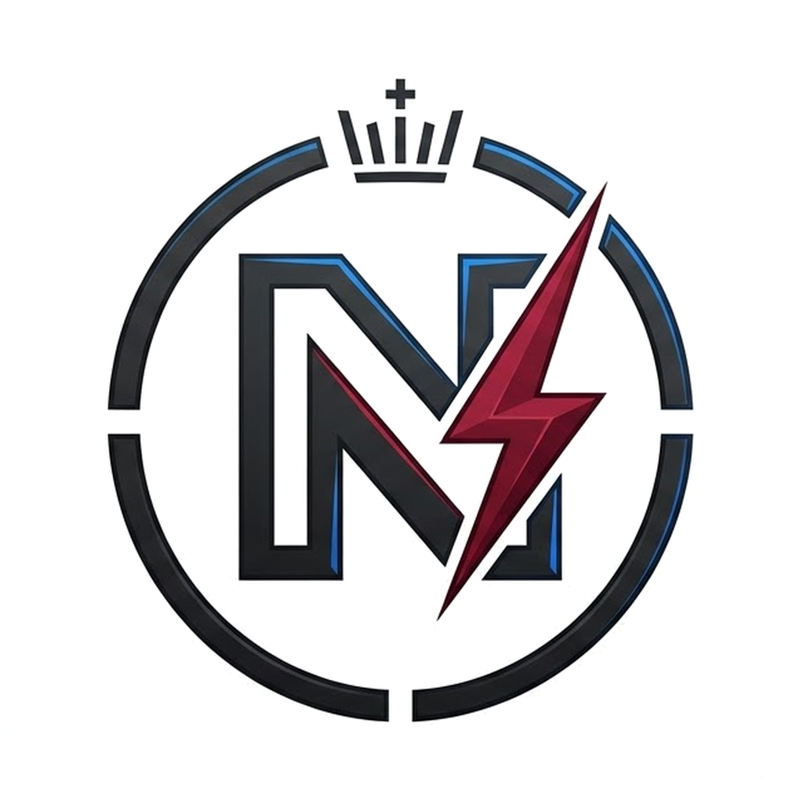
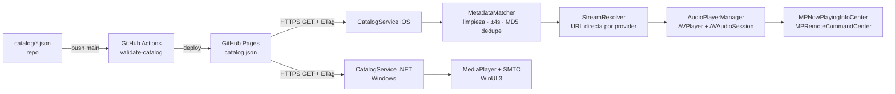

# Nsound

<p align="center"></p>

*Antes «LibreStream Hub». Nsound: la N de su logo (con la corona y el rayo) más «sound», sonido.*

Reproductor personal de música y vídeo, gratuito, sin ánimo de lucro y sin suscripciones. Código visible para uso no comercial (ver [LICENSE](LICENSE)).
El cliente iOS se distribuye como `.ipa` **sin firmar** que el usuario firma al instalar
(Sideloadly / AltStore / TrollStore). En Windows se distribuye como `.zip` portable (x64 y ARM64), sin instalador ni firma.

> **Fuentes de contenido:** el catálogo solo debe apuntar a contenido que se tenga derecho a
> redistribuir (dominio público, Creative Commons, Internet Archive, Jamendo, Free Music Archive,
> material propio…). El campo `source.provider` admite `youtube` únicamente como *referencia de
> metadatos/embebido oficial*; este repo **no** incluye extractores de streams de terceros.

> **YouTube (Windows):** al buscar, los resultados de YouTube aparecen como tarjetas dentro de la app y se
> reproducen con el reproductor oficial embebido (IFrame Player API), controlado por la barra de la app
> (play/pausa, anterior/siguiente, progreso, volumen). Se pueden guardar en «Mi biblioteca».
> No se extraen ni descargan streams.

> **Windows:** Inicio con éxitos del momento, Música por géneros (solo sonido), vídeos libres, letra sincronizada
> (LRCLIB, base de datos abierta), Mi biblioteca y listas de reproducción propias. Sin cuentas ni suscripciones.

> **Windows 0.5:** Vídeos con estanterías (La Velada del Año, series, YouTubers, deporte…), filtros estrictos
> (Música solo canciones y sin vídeo; Vídeos solo vídeos), anuncio de lanzamientos nuevos en Inicio, ecualizador de 10 bandas,
> descargas del catálogo libre (Creative Commons) y ajustes guardados. YouTube no se descarga: se reproduce con su reproductor oficial.

> **iOS y Android (0.5):** una única interfaz web (`app/`) con todas las funciones —Inicio con lanzamientos de la semana,
> Música por géneros, Vídeos con estanterías, Biblioteca y listas, letras sincronizadas, ecualizador, descargas del
> catálogo libre— dentro de una app nativa pequeña (`ios/` con WKWebView, `android/` con WebView).
> Windows sigue siendo nativo (WinUI 3) y comparte `app/src/eq.js`. Las apps móviles se compilan en GitHub Actions;
> aún no se han probado en un dispositivo real.

> **Licencia:** código visible, no libre de copiar. [PolyForm Noncommercial 1.0.0](LICENSE): puedes usarlo y modificarlo
> sin fines comerciales, pero no venderlo ni publicar copias comerciales; el nombre y el logo de Nsound son de la marca
> (ver [NOTICE](NOTICE)). Nsound no está afiliado a YouTube, Spotify, SoundCloud, Deezer ni Apple.

> **Instalar:** pasos para Windows, Android e iPhone en [docs/INSTALAR.md](docs/INSTALAR.md).

## Empieza aquí (si no sabes de informática)

1. **Elige tu sistema:** Windows, Android o iPhone.
2. **Sigue los pasos** de [docs/INSTALAR.md](docs/INSTALAR.md) (o de la [web del proyecto](https://vhkp259r94-cmyk.github.io/spotios/)).
3. **Abre Nsound** y busca una canción. Sin cuentas ni pagos.
4. Si algo falla, mira «Preguntas frecuentes» en la web o abre una incidencia en GitHub.

| Carpeta | Para qué sirve |
|---|---|
| `app/` | La interfaz que comparten iPhone y Android |
| `android/`, `ios/`, `windows/` | Cada app, por sistema |
| `docs/` | Guías: instalar y modificar |
| `site/` | La web del proyecto |
| `branding/` | Logo e iconos |

## Plan por fases

| Fase | Objetivo | Hitos |
|------|----------|-------|
| 0 | Fundaciones | Repo, `.gitignore`, convenciones, JSON Schema del catálogo |
| 1 | Datos | Catálogo en GitHub Pages, validación en CI, normalizador (`MetadataMatcher`) |
| 2 | Reproducción | `AudioPlayerManager` (AVPlayer, segundo plano, pantalla de bloqueo) |
| 3 | UI | SwiftUI: biblioteca, búsqueda, cola, mini‑reproductor, vídeo (AVPlayerViewController) |
| 4 | Distribución | `build-ipa.yml` → `.ipa` sin firmar en GitHub Releases por tag `v*` |
| 5 | Windows | Núcleo .NET 8 (mismos 21 casos), app WinUI 3 con controles multimedia del sistema, `build-windows.yml` → `.zip` en la misma Release |

## Estructura

```
.
├── .github/workflows/
│   ├── build-ipa.yml          # Compila y publica el .ipa
│   ├── build-windows.yml      # Tests .NET + .zip portable x64/ARM64
│   └── validate-catalog.yml   # Valida catálogo y tests del normalizador
├── catalog/catalog.json       # Catálogo de ejemplo (servido por GitHub Pages)
├── schemas/catalog.schema.json
├── ios/
│   ├── project.yml            # XcodeGen
│   ├── LibreStream/
│   │   ├── App/               # LibreStreamApp.swift (punto de entrada)
│   │   ├── Models/            # Models.swift (reflejan el JSON Schema)
│   │   ├── Services/
│   │   │   ├── Catalog/       # CatalogService.swift
│   │   │   ├── Matching/      # MetadataMatcher.swift
│   │   │   └── Playback/      # AudioPlayerManager.swift
│   │   ├── Views/{Library,Player}/
│   │   └── Resources/
│   └── LibreStreamTests/
├── app/                       # Interfaz compartida iOS + Android (HTML/CSS/JS, sin dependencias)
│   ├── src/{js,css,eq.js,index.template.html}
│   ├── test/core.test.mjs     # Pruebas de Node (node --test app/test)
│   ├── build.mjs              # Une todo en app/dist/index.html
│   └── dev/server.mjs         # Servidor local para probar en el navegador
├── android/                   # WebView + puente nativo (Kotlin) · APK en Releases
├── windows/
│   ├── LibreStream.Core/      # Models/, Services/{Catalog,Matching}/
│   ├── LibreStream.Core.Tests/# Matching/ (xUnit)
│   └── LibreStream.App/       # Services/AudioPlayerManager.cs, Views/MainWindow
├── docs/MODIFICAR.md          # Guía: dónde tocar cada cosa
└── tools/
    ├── validate_catalog.py    # Validación JSON Schema + dedupe
    └── test_title_regex.py    # Casos borde de regex (espejo del Swift)
```

## Flujo de datos



> ¿Quieres modificar algo? Mira [docs/MODIFICAR.md](docs/MODIFICAR.md).

## Desarrollo

```bash
python tools/test_title_regex.py && python tools/validate_catalog.py catalog/catalog.json
```

En Windows (requiere .NET 8 SDK): `dotnet test windows/LibreStream.Core.Tests` y `dotnet run --project windows/LibreStream.App -r win-x64 -p:Platform=x64`.

En macOS: `brew install xcodegen && cd ios && xcodegen && open LibreStream.xcodeproj`.

## Release

```bash
git tag v0.4.0 && git push origin v0.4.0
```
