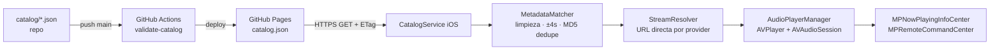

# LibreStream Hub

Centro de entretenimiento de código abierto, gratuito y sin suscripciones (música + vídeo).
El cliente iOS se distribuye como `.ipa` **sin firmar** que el usuario firma al instalar
(Sideloadly / AltStore / TrollStore).

> **Fuentes de contenido:** el catálogo solo debe apuntar a contenido que se tenga derecho a
> redistribuir (dominio público, Creative Commons, Internet Archive, Jamendo, Free Music Archive,
> material propio…). El campo `source.provider` admite `youtube` únicamente como *referencia de
> metadatos/embebido oficial*; este repo **no** incluye extractores de streams de terceros.

## Plan por fases

| Fase | Objetivo | Hitos |
|------|----------|-------|
| 0 | Fundaciones | Repo, `.gitignore`, convenciones, JSON Schema del catálogo |
| 1 | Datos | Catálogo en GitHub Pages, validación en CI, normalizador (`MetadataMatcher`) |
| 2 | Reproducción | `AudioPlayerManager` (AVPlayer, segundo plano, pantalla de bloqueo) |
| 3 | UI | SwiftUI: biblioteca, búsqueda, cola, mini‑reproductor, vídeo (AVPlayerViewController) |
| 4 | Distribución | `build-ipa.yml` → `.ipa` sin firmar en GitHub Releases por tag `v*` |

## Estructura

```
.
├── .github/workflows/
│   ├── build-ipa.yml          # Compila y publica el .ipa
│   └── validate-catalog.yml   # Valida catálogo y tests del normalizador
├── catalog/catalog.json       # Catálogo de ejemplo (servido por GitHub Pages)
├── schemas/catalog.schema.json
├── ios/
│   ├── project.yml            # XcodeGen
│   ├── LibreStream/
│   │   ├── App/LibreStreamApp.swift
│   │   ├── Core/{MetadataMatcher,AudioPlayerManager,CatalogService,Models}.swift
│   │   └── Resources/Info.plist
│   └── LibreStreamTests/MetadataMatcherTests.swift
└── tools/
    ├── validate_catalog.py    # Validación JSON Schema + dedupe
    └── test_title_regex.py    # Casos borde de regex (espejo del Swift)
```

## Flujo de datos



## Desarrollo

```bash
python tools/test_title_regex.py && python tools/validate_catalog.py catalog/catalog.json
```

En macOS: `brew install xcodegen && cd ios && xcodegen && open LibreStream.xcodeproj`.

## Release

```bash
git tag v0.1.0 && git push origin v0.1.0
```
