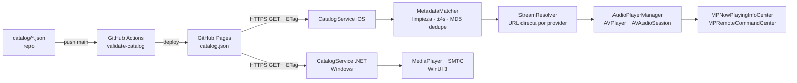

# LibreStream Hub

Centro de entretenimiento de código abierto, gratuito y sin suscripciones (música + vídeo).
El cliente iOS se distribuye como `.ipa` **sin firmar** que el usuario firma al instalar
(Sideloadly / AltStore / TrollStore). En Windows se distribuye como `.zip` portable (x64 y ARM64), sin instalador ni firma.

> **Fuentes de contenido:** el catálogo solo debe apuntar a contenido que se tenga derecho a
> redistribuir (dominio público, Creative Commons, Internet Archive, Jamendo, Free Music Archive,
> material propio…). El campo `source.provider` admite `youtube` únicamente como *referencia de
> metadatos/embebido oficial*; este repo **no** incluye extractores de streams de terceros.

> **YouTube (Windows):** al buscar, los resultados de YouTube aparecen como tarjetas dentro de la app y se
> reproducen con el reproductor oficial embebido (IFrame Player API), controlado por la barra de la app
> (play/pausa, anterior/siguiente, progreso, volumen). Se pueden guardar en «Mi biblioteca».
> No se extraen ni descargan streams. Un filtro de red bloquea servidores de anuncios y rastreo conocidos;
> los anuncios que YouTube sirve desde sus propios servidores de vídeo pueden seguir apareciendo.

## Plan por fases

| Fase | Objetivo | Hitos |
|------|----------|-------|
| 0 | Fundaciones | Repo, `.gitignore`, convenciones, JSON Schema del catálogo |
| 1 | Datos | Catálogo en GitHub Pages, validación en CI, normalizador (`MetadataMatcher`) |
| 2 | Reproducción | `AudioPlayerManager` (AVPlayer, segundo plano, pantalla de bloqueo) |
| 3 | UI | SwiftUI: biblioteca, búsqueda, cola, mini‑reproductor, vídeo (AVPlayerViewController) |
| 4 | Distribución | `build-ipa.yml` → `.ipa` sin firmar en GitHub Releases por tag `v*` |
| 5 | Windows | Núcleo .NET 8 (mismos 21 casos), app WinUI 3 con controles multimedia del sistema, `build-windows.yml` → `.zip` en la misma Release |

## Estructura

```
.
├── .github/workflows/
│   ├── build-ipa.yml          # Compila y publica el .ipa
│   ├── build-windows.yml      # Tests .NET + .zip portable x64/ARM64
│   └── validate-catalog.yml   # Valida catálogo y tests del normalizador
├── catalog/catalog.json       # Catálogo de ejemplo (servido por GitHub Pages)
├── schemas/catalog.schema.json
├── ios/
│   ├── project.yml            # XcodeGen
│   ├── LibreStream/
│   │   ├── App/               # LibreStreamApp.swift (punto de entrada)
│   │   ├── Models/            # Models.swift (reflejan el JSON Schema)
│   │   ├── Services/
│   │   │   ├── Catalog/       # CatalogService.swift
│   │   │   ├── Matching/      # MetadataMatcher.swift
│   │   │   └── Playback/      # AudioPlayerManager.swift
│   │   ├── Views/{Library,Player}/
│   │   └── Resources/
│   └── LibreStreamTests/
├── windows/
│   ├── LibreStream.Core/      # Models/, Services/{Catalog,Matching}/
│   ├── LibreStream.Core.Tests/# Matching/ (xUnit)
│   └── LibreStream.App/       # Services/AudioPlayerManager.cs, Views/MainWindow
├── docs/MODIFICAR.md          # Guía: dónde tocar cada cosa
└── tools/
    ├── validate_catalog.py    # Validación JSON Schema + dedupe
    └── test_title_regex.py    # Casos borde de regex (espejo del Swift)
```

## Flujo de datos



> ¿Quieres modificar algo? Mira [docs/MODIFICAR.md](docs/MODIFICAR.md).

## Desarrollo

```bash
python tools/test_title_regex.py && python tools/validate_catalog.py catalog/catalog.json
```

En Windows (requiere .NET 8 SDK): `dotnet test windows/LibreStream.Core.Tests` y `dotnet run --project windows/LibreStream.App -r win-x64 -p:Platform=x64`.

En macOS: `brew install xcodegen && cd ios && xcodegen && open LibreStream.xcodeproj`.

## Release

```bash
git tag v0.3.0 && git push origin v0.3.0
```
